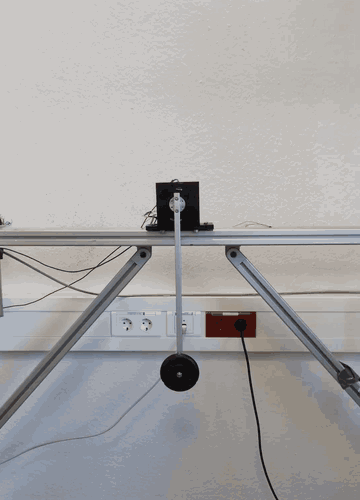
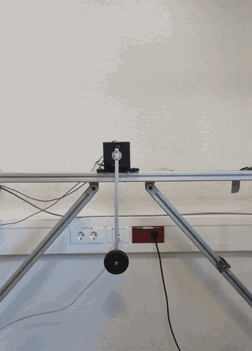
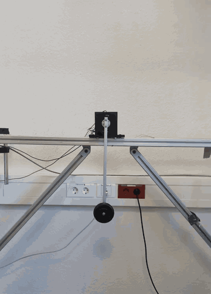

## Rules

The real system leaderboard compares the performance of different control
methods on the real hardware. The task for the controller is to swingup and
balance the simple pendulum at the upright position.

<figcaption>Videos from left to right: iLQR MPC, Energy Shaping and LQR, SAC</figcaption>

The model parameters identified by us for the simple pendulum are:

  - Gravity: $g = 9.81 \, \frac{\text{m}}{\text{s}^2}$
  - Mass: $m = 0.6755 \, \text{kg}$
  - Length: $l = 0.4 \, \text{m}$
  - Inertia: $I = m l^2 = 0.108 \, \text{kg m}^2$
  - Damping friction: $b = 0.1 \, \frac{\text{kg m}^2}{\text{s}}$
  - Coulomb friction: $c_f = 0.1 \, \text{N m}$
  - Torque limit: $\tau_{max} = 1.5 \, \text{N m}$

The controllers are free to use different model parameters internally.

More information about the dynamic model of the simple pendulum can be found
here: [Simple Pendulum
Model](https://github.com/dfki-ric-underactuated-lab/torque_limited_simple_pendulum/tree/master/software/python/simple_pendulum/model).

The pendulum is controlled with a control frequency of $100\, \text{Hz}$
($dt = 0.01 \, \text{s}$) and the experiment takes $10\,\text{s}$.
The initial pendulum configuration is $x_0 = (0, 0)$ (hanging down) and the
goal is the unstable fixpoint at the upright configuration $x_g = (\pi, 0)$.
The upright position is considered to be reached when the position is within
$0.15 \, \text{rad}$ and the velocity is within $1.5 \, \frac{\text{rad}}{\text{s}}$
of the goal state and stays there until the end. Turning the pendulum up
clockwise or counter-clockwise (i.e. reaching $\pi$ or $-\pi$) are both valid.

## Scores

For the evaluation multiple criteria are evaluated and weighted to calculate an
overall score (RealAI Score). The criteria are:

  - **Swingup Success** $c_{success}$: Whether the swingup was successful, i.e. if the
    pendulum is in the goal region in the end of the experiment.
  - **Swingup time** $c_{time}$: The time it takes for the pendulum to reach
    the goal region and *stay there*. If the pendulum enters the goal region
    but leaves it before the experiment time is over the swingup is not
    considered successful! The swingup time is the time when the pendulum
    enters the goal region and does not leave the region until the end.
  - **Energy** $c_{energy}$: The mechanical energy used during the execution.
  - **Max. Torque** $c_{\tau, max}$: The peak torque that was used during the
    execution.
  - **Integrated Torque** $c_{\tau, integ}$: The time integral over the
    absolute torque ( $c_{\tau, integ} = \sum |u| \Delta t$ ).
  - **Torque Cost** $c_{\tau, cost}$: A quadratic cost on the used torques (
    $c_{\tau, cost} = \sum u^TRu \Delta t$, with R = 1).
  - **Torque Smoothness** $c_{\tau, smooth}$: The standard deviation of the
    changes in the torque signal.
  - **Velocity Cost** $c_{vel, cost}$: A quadratic cost on the velocities
    that were reached during the execution ( $c_{vel} = \sum \dot{q}^T Q \dot{q} \Delta t$,
    with Q = 1)

These criteria are used to calculate the overall Real AI Score with the formula

$$
\begin{equation}
S = c_{success} \left( 1 -
\sum_{i \in \{ 'time', 'energy', '\tau, max', '\tau, integ', '\tau, cost', '\tau, smooth', 'vel, cost' \}}
w_{i} \frac{c_{i}}{n_{i}}\right)
\end{equation}
$$

The weights and normalizations are:

| Criterion         | weight $w$ | normalization $n$ |
| ------------------|------------|-------------------|
| Swingup Time      | 0.2        | 10.0              |
| Energy            | 0.1        | 100.0             |
| Max. Torque       | 0.1        | 2.0               |
| Integrated Torque | 0.1        | 20.0              |
| Torque Cost       | 0.1        | 40.0              |
| Torque Smoothness | 0.2        | 4.0               |
| Velocity Cost     | 0.2        | 100.0             |

The listed number for swingup time, energy, etc. in the leaderboard are the
scores from the best attempt. The 'Best RealAI Score' is the score of that
attempt. The 'Average RealAI Score' is the average score over all attempts.
Unsuccessful swingups (where the pendulum is not in the goal region in the end
of the experiment (i.e. after $10\,\text{s}$)) have a score of 0.

## Participating

If you want to participate in this leaderboard with your own controller have a
look at the [simple pendulum
repository](https://github.com/dfki-ric-underactuated-lab/torque_limited_simple_pendulum).
We recommend submitting the controller first to the simple pendulum
[simulation
leaderboard](https://dfki-ric-underactuated-lab.github.io/real_ai_gym_leaderboard/simple_pendulum_simulation_performance_leaderboard.html).
Experiments with the real hardware can be conducted remotely. Please contact
shivesh.kumar@dfki.de or felix.wiebe@dfki.de for details and scheduling.
